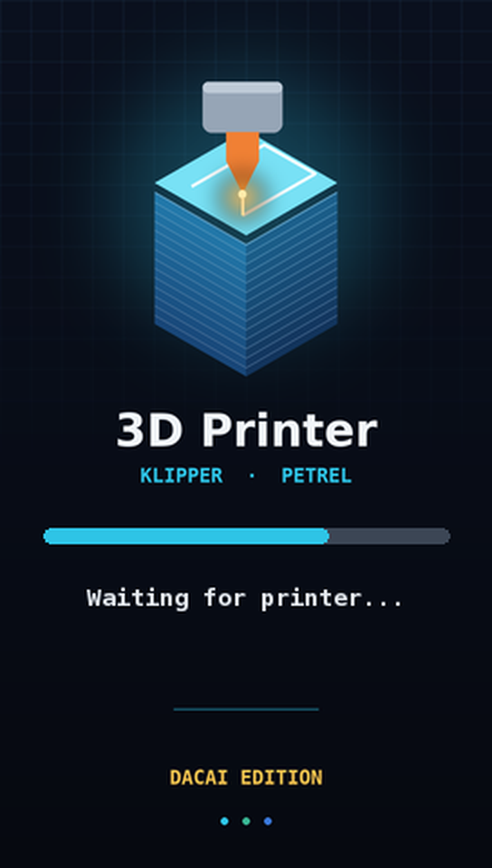
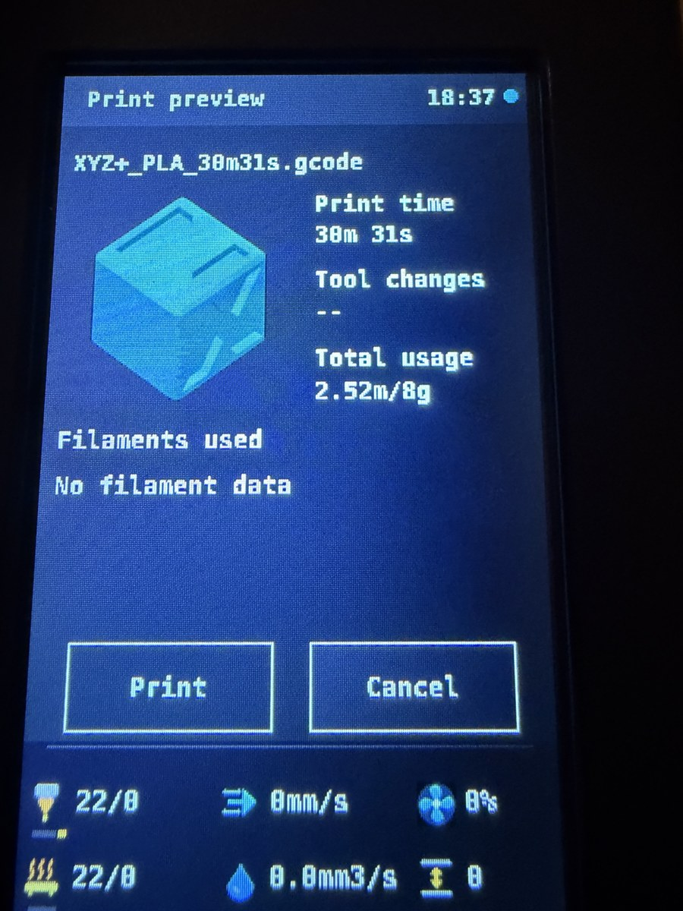
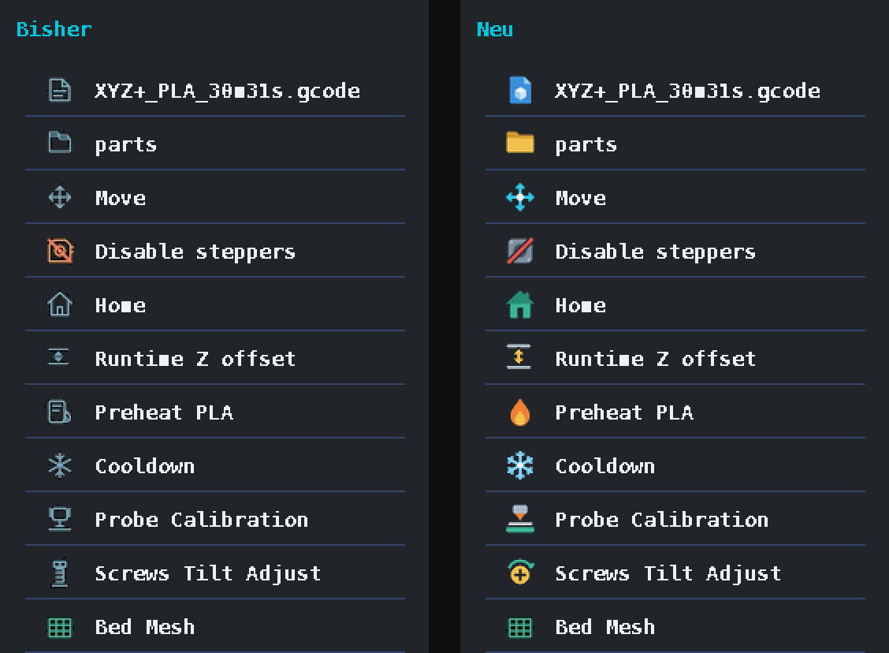

# Petrel für DACAI-Displays

**Das originale Creality-Display mit Drehknopf unter Klipper wiederbeleben – auch wenn es ein DACAI ist.**

[English](README.md) · [Anleitung für KI-Assistenten](AGENTS.md) · [Protokoll-Notizen](docs/dacai-protocol.md)

<p align="center">
  
  &nbsp;&nbsp;
  
  &nbsp;&nbsp;
  
</p>

Viele Creality-Drucker (Ender-3 V2 Neo, Ender-3 Max Neo, manche Ender-3 V2 / S1) haben statt
des originalen **DWIN T5UIC1** ein **DACAI**-Display. Es sieht gleich aus und versteht *fast*
dasselbe Protokoll – aber eben nicht alles. Wer so einen Drucker auf Klipper umstellt und
[Petrel](https://github.com/sezgynus/Petrel) nutzt, bekommt fehlende Icons, chinesische
Textfetzen, ein kaputtes Startlogo oder gar keine Verbindung.

Hier liegt alles, was nötig war, damit Petrel auf einem DACAI-Display richtig läuft:

| | Was | Wo |
|---|---|---|
| 🔧 | 6 kleine Patches für Petrel (jeder per Schalter in `Petrel.env`) | [`patches/`](patches/) |
| 🖼️ | Fertiges SD-Karten-Paket: 189 Icons (74 im gefüllten Farbstil neu gezeichnet + 3 neue), neutrales Startbild, klare Monospace-Schrift | [`sd-overlay/`](sd-overlay/) |
| 🧰 | Werkzeuge: DWIN oder DACAI erkennen, Icon-Bibliothek (ZICO) bauen, Schrift bauen, Startbild rendern, SD-Ordner zusammenstellen | [`tools/`](tools/) |
| 📖 | Was DACAI anders macht – soweit bekannt erstmals dokumentiert | [`docs/dacai-protocol.md`](docs/dacai-protocol.md) |
| 🏠 | Optional für Home Assistant: Drucker einschalten → Klipper verbindet sich von selbst | [`examples/home-assistant/`](examples/home-assistant/) |

> **Getestet:** Ender-3 Max Neo (Creality-Board 4.2.2), Raspberry Pi 5, Klipper 0.13,
> Moonraker 0.11, Petrel `9907edf` (v7.0.0-37). Andere DACAI-Drucker sollten sich gleich
> verhalten – Rückmeldungen willkommen.

## ⚠️ Vorher lesen

* **Niemals einen `DWIN_SET`-Ordner auf ein DACAI-Display spielen.** DACAI nutzt den Ordner `private`.
* **Petrel nie ungepatcht mit einem DACAI-Display starten.** Beim ersten Start lädt Petrel
  Grafiken über das Kabel hoch, DACAI nimmt sie halb an, und das Startbild ist danach kaputt
  (per SD-Update reparierbar). Die Reihenfolge unten verhindert das.
* Vor dem Umstecken Display und Pi stromlos machen.

## Was du bekommst

* Die komplette Petrel-Oberfläche am Original-Display: Drucken mit **Vorschaubild**, Tune,
  Prepare, Leveling (Bed Mesh, Schrauben, Z-Offset), Wartungserinnerungen, Info.
* Gefüllte Farb-Icons, eine klarere fette Schrift (DejaVu Sans Mono), eigenes Startbild.
* Display wird **dunkel, solange der Drucker aus ist**, und geht an, sobald Klipper bereit ist
  (ohne Strommesser).
* ★ Optional mit Home Assistant: beim Einschalten automatisch `FIRMWARE_RESTART`.
* Wartung: **Riemen & Rollen** für X/Y und **Gewindestange reinigen & fetten** für Z.

## Installation (Kurzfassung)

Ausführlich: [`docs/install.md`](docs/install.md) · Verkabelung: [`docs/wiring.md`](docs/wiring.md)

1. Display an den Pi anschließen (5 V, GND, UART, Drehknopf) und UART einschalten.
2. `python3 tools/dacai_probe.py` → muss *DACAI panel* melden.
3. Petrel klonen und **vor** der Installation patchen:
   ```bash
   git clone https://github.com/sezgynus/Petrel.git ~/Petrel
   cd ~/Petrel
   git checkout -b dacai 9907edfac4a6e50b4c71f25613d522ffec4a49ba
   git -c user.name=me -c user.email=me@localhost am ~/petrel-dacai/patches/000*.patch
   ```
4. [`examples/Petrel.env`](examples/Petrel.env) nach `~/.config/Petrel/Petrel.env` kopieren.
5. `cd ~/Petrel && bash install.sh`
6. SD-Ordner bauen (`tools/make_sd_package.py`) und aufspielen: [`docs/sd-update.md`](docs/sd-update.md).
7. Petrel neu starten – fertig.

## Welches „Firmware-Update“ ist was?

| Was | Hier erklärt? |
|---|---|
| **Display-Grafik** (Icons, Schrift, Startbild) per microSD | ✅ [`docs/sd-update.md`](docs/sd-update.md) – inkl. Rückweg zum Original |
| **Petrel** (die Oberfläche auf dem Pi) | ✅ [README.md → Updating Petrel](README.md#updating-petrel) |
| **Klipper-Firmware auf dem Drucker-Mainboard** | ❌ nicht Teil dieses Projekts – der Drucker muss schon mit Klipper laufen |
| **Betriebssystem/Bootloader des Display-Controllers** | ❌ nie nötig, nicht flashen |

**Leicht zu übersehen:** Vorschaubilder brauchen Thumbnails im G-Code (im Slicer einschalten, z. B. OrcaSlicer `32x32/PNG, 300x300/PNG`), und die Vorheiz-Knöpfe kommen aus den Mainsail-Presets. Details in [`docs/install.md`](docs/install.md).

## ★ Optionale Add-ons

Für die Grundfunktion brauchst du nur Pi, Display, Kabel und eine SD-Karte. Alles mit ★ ist Zusatz:

| ★ Add-on | Du brauchst | Was es macht |
|---|---|---|
| **Autostart über Home Assistant** | Home Assistant, die Moonraker-Integration und eine Steckdose, die den Strom **misst** | Drucker einschalten → Home Assistant schickt `FIRMWARE_RESTART` → nach ~20 s bereit. Ohne Add-on: `FIRMWARE_RESTART` wie gewohnt in Mainsail/Fluidd. → [`examples/home-assistant/`](examples/home-assistant/) |
| **Eigenes Startbild** | nichts extra | `tools/make_boot.py --title "Mein Drucker" mein_boot.jpg`, dann SD-Ordner mit `--boot mein_boot.jpg` neu bauen |
| **Eigene Icons / Schrift** | Python mit Pillow (+ fonttools) | `tools/make_icons.py` bzw. `tools/build_font.py` anpassen und neu bauen |

Das Dunkelschalten des Displays bei ausgeschaltetem Drucker braucht **keinen** Strommesser – Petrel erkennt das direkt an Klipper.

## Lizenzen

Petrel (sezgynus) steht unter GPL-3.0; die Patches und dieses Projekt ebenfalls. DejaVu-Schriften:
freie Lizenz ([`LICENSES/DejaVu.txt`](LICENSES/DejaVu.txt)). Original-Dateien von Creality sind
**nicht** enthalten – nimm die Dateien deiner eigenen Display-Firmware. Kein Bezug zu Creality,
DWIN, DACAI oder dem Petrel-Autor.
