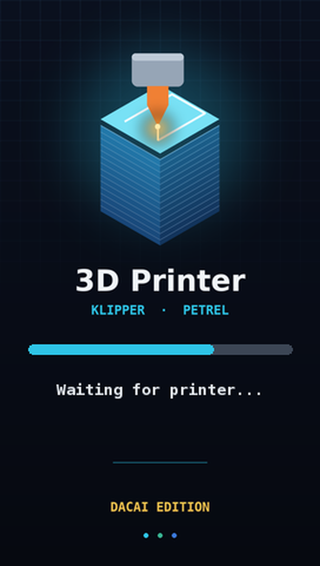
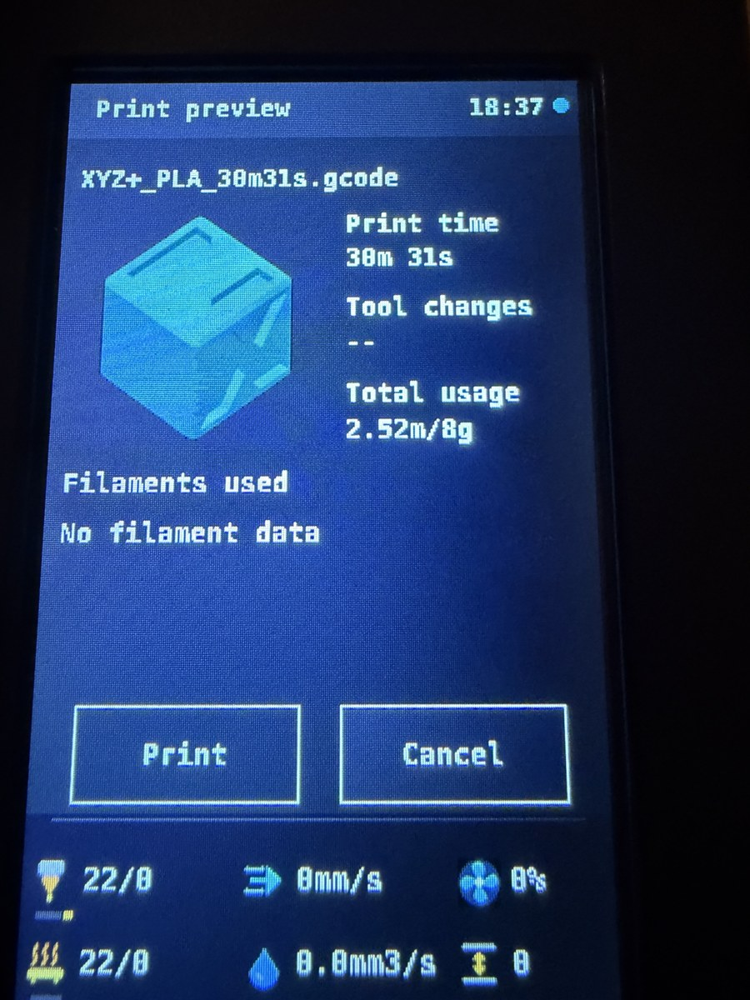
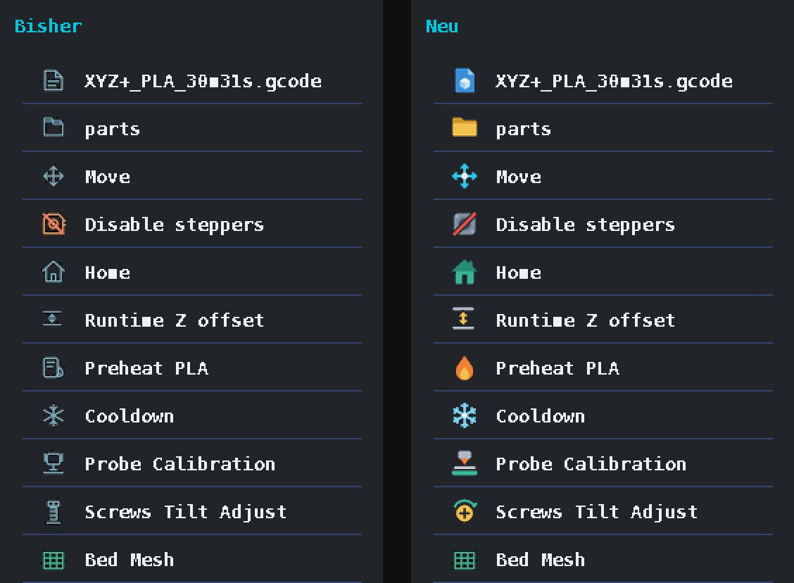

# Petrel for DACAI screens

**Bring the stock Creality knob screen back to life on Klipper – even if it is a DACAI panel.**

[Deutsch](README.de.md) · [Guide for AI assistants](AGENTS.md) · [Protocol notes](docs/dacai-protocol.md)

<p align="center">
  
  &nbsp;&nbsp;
  
  &nbsp;&nbsp;
  
</p>

Many Creality printers (Ender-3 V2 Neo, Ender-3 Max Neo, some Ender-3 V2 / S1 batches) ship
with a **DACAI** screen instead of the original **DWIN T5UIC1**. It looks identical and
speaks *most* of the DWIN protocol – but not all of it. When you move such a printer to
Klipper and try a DWIN screen UI like [Petrel](https://github.com/sezgynus/Petrel), you get
missing icons, Chinese text snippets, a corrupted boot logo, or a screen that never connects.

This project contains everything that was needed to make Petrel work properly on a DACAI panel:

| | What | Where |
|---|---|---|
| 🔧 | A `DacaiDriver` for Petrel (proposed upstream): artwork **and icons go over the UART – no microSD card needed** – plus 6 optional extras | [`patches/`](patches/) |
| 🖼️ | ★ Optional microSD overlay: 189 icons (74 redrawn in a filled colour style + 3 new), a neutral boot image, a crisp monospace font | [`sd-overlay/`](sd-overlay/) |
| 🧰 | Tools: detect DWIN vs. DACAI, build icon libraries (ZICO), build fonts, render boot images, assemble the SD folder | [`tools/`](tools/) |
| 🛟 | ★ For solderers: FEL access over the screen's USB pins – full flash backup, rescue, native icons and animations | [`docs/fel.md`](docs/fel.md), [`tools/fel/`](tools/fel/) |
| 📖 | What DACAI does differently – documented for the first time as far as we know | [`docs/dacai-protocol.md`](docs/dacai-protocol.md) |
| 🏠 | Optional Home Assistant automation: printer switched on → Klipper connects by itself | [`examples/home-assistant/`](examples/home-assistant/) |

## Tested with

| Component | Version |
|---|---|
| **Petrel** | **v7.0.0-54, commit [`764d406`](https://github.com/sezgynus/Petrel/commit/764d40684ee8485a7d00ffb9df9fc0add77b79c1)** (2026-11-11, after the source reorganisation). Patches for the older v7.0.0-37 (`9907edf`): [`patches/legacy-9907edf/`](patches/legacy-9907edf/) |
| Klipper / Moonraker / Mainsail | v0.13.0-745 / v0.11.0 / 2.19 |
| Raspberry Pi | Pi 5, Debian 13 (Raspberry Pi OS), UART `/dev/ttyAMA0` |
| Printer / screen | Ender-3 Max Neo (Creality 4.2.2), DACAI 4.3" knob screen |
| **Screen firmware** | **Creality's official Max Neo display firmware**: `firmware.zlib` (build May 18 2022) from the Creality package `SW-V1.4.1_C` (20 Oct 2022) – see below |

> **Screen firmware matters.** Thumbnails (`0x70`), picture upload over UART and therefore the
> SD-free icons were only verified **with that official firmware**; the screen had an older
> factory firmware before. Animations, virtual areas and the `0x27` fix also worked on the
> factory firmware. If icons or thumbnails stay empty on your screen, install Creality's display
> firmware from the microSD card first (see [`docs/sd-update.md`](docs/sd-update.md)) – and
> please report your result.

The patches are made for exactly this Petrel commit – the install steps check it out
explicitly. Newer Petrel versions may need the patches to be rebased (see
[Updating Petrel](#updating-petrel)). Other DACAI printers should behave the same – reports welcome.

---

## ⚠️ Read this first

* **Never flash a `DWIN_SET` folder onto a DACAI screen.** DACAI uses a folder called
  `private` instead. DWIN files can leave the panel unusable.
* **Do not start unpatched Petrel on a DACAI screen.** On its first start plain Petrel uploads
  a DWIN icon library over the UART, which DACAI stores as broken pictures (fixable with
  `tools/dacai_artwork.py` once patched, but annoying). Follow the order below.
* You work on mains-powered hardware. Power the screen and the Pi off before rewiring.

## What you get

Everything below works with **just a Pi, the screen and some wires** – no extra hardware,
no Home Assistant.

* Petrel's full UI on the stock knob screen: printing with **model thumbnails**, tune, prepare,
  leveling (bed mesh, screw tilt, probe calibration), maintenance reminders, info.
* **No microSD card:** boot picture, shared artwork and all icons are uploaded over the UART on
  the first start (about 15 s), afterwards only changed pictures. Icon animations (boot progress,
  fan) are driven by the Pi.
* ★ With the SD overlay: filled colour icons and a cleaner bold font (DejaVu Sans Mono).
* Screen goes **dark while the printer is switched off** and lights up again when Klipper is
  ready (detected from Klipper itself, no power meter needed).
* Maintenance: **belt & roller check** for X/Y and **lead screw clean & lube** for Z, friendly
  device names.

Things marked **★** are optional add-ons – skip them if you do not have the extra hardware.
See [Optional add-ons](#-optional-add-ons).

## Hardware

**Required**

* Stock Creality knob screen with a **DACAI** controller (check with `tools/dacai_probe.py`)
* Raspberry Pi running Klipper + Moonraker (tested: Pi 5; Pi 3/4 should work the same way)
* 7 jumper wires (female–female) or the original ribbon cable plus adapters
* a multimeter for one quick voltage check
* ★ microSD card (≤ 32 GB, FAT32) – only for the optional SD overlay (own font / icons)

**Only in special cases**

* Pi 5 with an M.2 HAT: a tall stacking header so the GPIO pins stick out
* ★ Home Assistant + a power-measuring smart plug: only for the autostart add-on

## Installation (overview)

Detailed steps: [`docs/install.md`](docs/install.md). Wiring: [`docs/wiring.md`](docs/wiring.md).

1. **Wire** the screen to the Pi (5 V, GND, UART TX/RX, encoder A/B/button) and enable the
   UART (`dtparam=uart0=on` on a Pi 5, then reboot).
2. **Probe** the screen: `python3 tools/dacai_probe.py` → must report *DACAI panel*.
3. **Get Petrel and apply the patches** *before* installing it:
   ```bash
   git clone https://github.com/sezgynus/Petrel.git ~/Petrel
   cd ~/Petrel
   git checkout -b dacai 764d40684ee8485a7d00ffb9df9fc0add77b79c1
   git -c user.name=me -c user.email=me@localhost am ~/petrel-dacai/patches/00*.patch
   ```
4. **Create `~/.config/Petrel/Petrel.env`** from [`examples/Petrel.env`](examples/Petrel.env)
   (this also makes the installer skip its configuration menu). It sets `PETREL_DACAI=1`.
5. **Install:** `cd ~/Petrel && bash install.sh` (needs sudo). On the first start Petrel uploads
   its artwork and icon sheets over the UART (about 15 s) – done.
6. ★ Optional: own font / redrawn icons via the SD overlay, see [`docs/sd-update.md`](docs/sd-update.md).

## The patches

| # | Switch in `Petrel.env` | What it does |
|---|---|---|
| 0001 | – | Small extension points in Petrel's DWIN driver; no change for DWIN screens |
| 0002 | `PETREL_DACAI=1`, `PETREL_DACAI_BAUD` | **`DacaiDriver`**: thumbnails with DACAI's `0x70`, `0x27` bit 7 fix, pictures padded to 32 KB, **icons as JPEG sprite sheets over UART** (pictures 16+, drawn with `0x25` + `0x27`), animations from the Pi, bare `A5 OK` flash ACK, brightness 0–63, faster host link via `0x38`; `tools/dacai_artwork.py` re-uploads after an SD update |
| 0003 | – | `configure.sh` menu *Display panel* and Petrel's own `docs/dacai.md` (EN/TR) |
| 0004 | `PETREL_DACAI=1` | Print previews composed on the UI background instead of black (DACAI's `0x70` draws opaque) – no black square, only a thin JPEG colour fringe at model edges |
| 0005 | `PETREL_HIDE_QR=1` | Hides the project QR code on the Info page |
| 0006 | `PETREL_DARK_WHEN_PRINTER_OFF=1` | Backlight off while Klipper reports the printer board unreachable; the knob wakes it for 10 s |
| 0007 | – | Maintenance: belt / lead-screw tasks, friendly names, X/Y/Z badges (icons 186–188 come with the SD overlay) |
| 0008 | `PETREL_BOOT_ARTWORK=…` | Own boot picture, uploaded over UART |
| 0009 | `PETREL_DACAI_PANEL_ICONS=1` | ★ Use the screen's own icon library (`icon/2.zico`, via microSD or [FEL](docs/fel.md)) instead of sprite sheets – your own icons, native `0x28` animations |
| 0010 | `PETREL_FILE_THUMBNAILS=1` | Small model pictures instead of the file icon in the file list (also works on DWIN) |

0001–0004 are the part proposed to Petrel upstream. `patches/petrel-dacai-all.patch` contains
all ten as one diff. The previous SD-based series is kept in
[`patches/legacy-764d406-sd/`](patches/legacy-764d406-sd/).

## ★ Optional add-ons

None of these is needed for the screen to work.

| ★ Add-on | You need | What it does |
|---|---|---|
| **Autostart via Home Assistant** | Home Assistant, the Moonraker integration and a smart plug that **measures** the printer's power | When you switch the printer on, Klipper normally stays in `Lost communication with MCU` until someone sends `FIRMWARE_RESTART`. The automation sends it as soon as the printer draws power – switch on, wait ~20 s, ready. → [`examples/home-assistant/`](examples/home-assistant/) |
| **Own boot image** | nothing extra | `tools/make_boot.py --title "My Printer" --info "220 × 220 × 250 mm" my_boot.jpg`, then set `PETREL_BOOT_ARTWORK=/path/my_boot.jpg` (patch 0008) – uploaded over UART |
| **Own font / redrawn icons** | microSD card, Python with Pillow (+ fonttools for the font) | SD overlay, see [`docs/sd-update.md`](docs/sd-update.md) and [AGENTS.md](AGENTS.md#practical-notes-for-agents) |
| **FEL access** | soldering iron, an old USB cable, a spare microSD card | Three solder joints at J3 give raw access to the screen's flash over USB: backup, rescue, native icons/animations, clean-up → [`docs/fel.md`](docs/fel.md) |

Without the Home Assistant add-on you simply send `FIRMWARE_RESTART` from Mainsail/Fluidd (or
from the screen's recovery page) after switching the printer on – exactly as before.

## Which "firmware update" is which?

| What | Covered here? |
|---|---|
| **Screen artwork** over UART (boot image, icons) | ✅ automatic with `PETREL_DACAI=1` |
| ★ **Screen artwork** via microSD (font, redrawn icons) | ✅ [`docs/sd-update.md`](docs/sd-update.md) – incl. the way back to stock |
| **Petrel** (the UI software on the Pi) | ✅ below |
| **Klipper firmware on the printer mainboard** | ❌ not part of this project – your printer must already run Klipper ([Klipper docs](https://www.klipper3d.org/Installation.html)) |
| **Screen controller kernel / bootloader** | ❌ never needed, do not flash it |

## Updating Petrel

Petrel is developed very actively. Your install now lives on a local branch `dacai`, so
Moonraker's update manager will not overwrite it by accident. To move to a newer Petrel, rebase
the branch (`git fetch && git rebase origin/master`) and fix conflicts if any – or simply stay
on the tested commit. Petrel re-uploads only artwork that changed. After a screen **microSD**
update run `tools/dacai_artwork.py` once (see Petrel's `docs/dacai.md`), because the SD update
removes the uploaded pictures.

## Credits & licenses

* **[Petrel](https://github.com/sezgynus/Petrel)** by sezgynus – GPL-3.0. The patches in this
  repository modify Petrel and are therefore GPL-3.0 as well. Icon IDs 0–185 that were not
  redrawn are Petrel's artwork.
* **DejaVu fonts** – free license, see [`LICENSES/DejaVu.txt`](LICENSES/DejaVu.txt). The SD
  font is a modified DejaVu Sans Mono Bold.
* The DACAI `private` folder layout and stock files are Creality's. They are **not included**;
  use the files of your own screen firmware. The community collection in
  [mriscoc/Ender3V2S1](https://github.com/mriscoc/Ender3V2S1/tree/Ender3V2S1-Bugfix/display%20assets)
  was a great help for understanding the layout.
* Everything else (tools, redrawn icons, boot image, documentation): GPL-3.0, see [`LICENSE`](LICENSE).

This project is not affiliated with Creality, DWIN, DACAI or the Petrel author.
