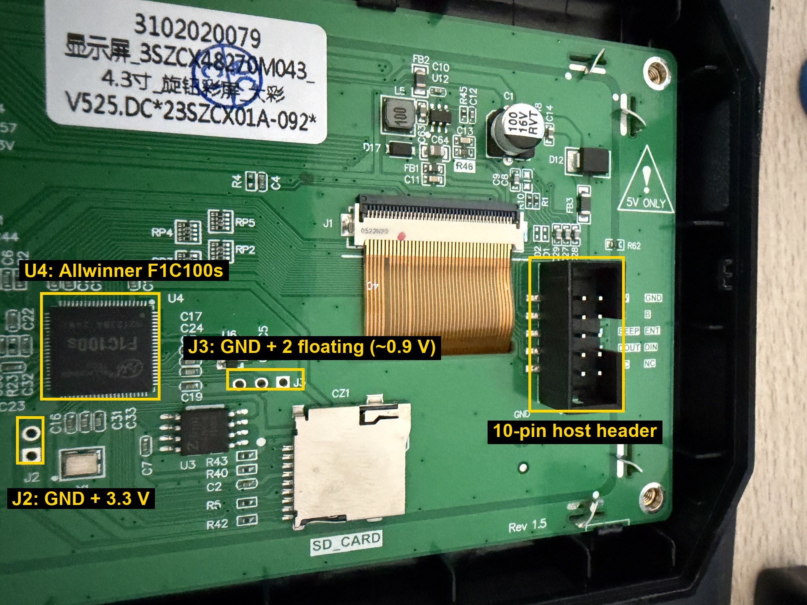
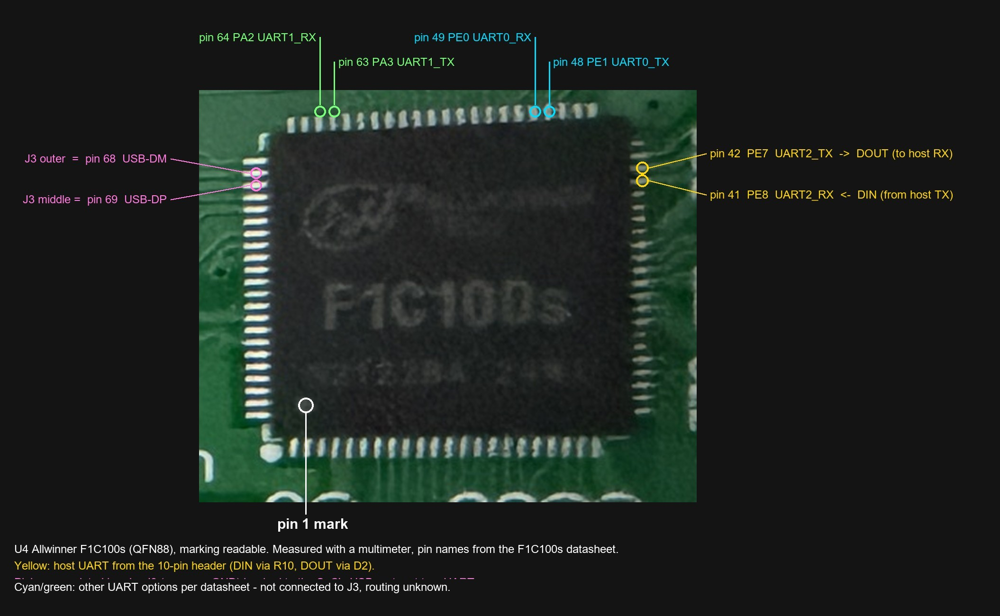

# DACAI vs. DWIN T5UIC1 – what is different

Findings from a Creality DACAI 4.3" knob screen (sticker `…SZCX48270M043_4.3寸_旋钮彩屏 V525`,
272×480 portrait) attached to a Raspberry Pi UART at 115200 8N1. Frames use the usual T5UIC1
layout `AA <cmd> <payload> CC 33 C3 3C`.

## Works like DWIN

| Command | | Notes |
|---|---|---|
| `0x00` handshake | ✅ | answers `AA 00 4F 4B CC 33 C3 3C` |
| `0x05` rectangle (fill/outline) | ✅ | used for all drawing and for thumbnails |
| text drawing | ✅ | rendered with the TrueType font from `private/truefont` |
| `0x23` show icon | ✅ | icon libraries come from `private/icon/N.zico` |
| `0x22` show JPEG from flash, area copy from picture 1 | ✅ | pictures come from `private/image/N.jpg` |
| `0x30` backlight | ✅ | 0 = dark |
| `0x32` read SRAM / data flash | ✅ | framed answer as on DWIN |
| `0x02` points | ✅ | small points look like outlined squares at 4×4 |
| `0x09` move area (scroll) | ✅ | mode 1 (translate) + fill colour as on DWIN |
| `0x14` native number | ✅ | |
| `0x21` QR code | ✅ | |
| `0x30` backlight levels | ⚠️ | levels work, but the range is small (0x10…0xFF only "a bit darker") |
| `0x28` / `0x29` native icon animation | ✅ | runs on the panel by itself, several channels at once, no `0x3D` refresh needed (tested: 2 channels, icons 181–185 and 166–173) |
| `0x25` cache JPEG to area 1 + `0x26` copy from area 1 | ✅ | cache does not change the screen; copy is opaque (black pixels copied) |
| `0x27` copy from area 0 (picture shown by `0x22`) | ⚠️ | works, but bit 7 is inverted – see below |

## Different

* **`0x03` polyline: only horizontal/vertical.** Diagonal segments are drawn as an L-shaped
  step (horizontal + vertical). Horizontal and vertical lines are fine.
* **`0x08` bitmap and `0x2A` EAN-13: nothing is drawn.** (Petrel does not use them.)

1. **Drawing needs `0x3D` (update).** Drawing commands only become visible after
   `AA 3D CC 33 C3 3C`. (Petrel sends it anyway; your own test scripts must too.)
2. **Unframed acknowledgements.** Writes answer with raw bytes, without `AA` header and tail:
   * data-flash write `0x31 A5 …` → `A5 4F 4B` (DWIN: `AA 31 A5 4F 4B CC 33 C3 3C`)
   * SRAM write `0x31 5A …` → `5A 4F 4B` (DWIN: no answer) – a handy non-destructive way to tell
     the two panels apart (`tools/dacai_probe.py`).
3. **JPEG from SRAM uses `0x70`, not `0x24`.** `0x24` does nothing in every mode tested.
   DACAI has its own command (also used by Marlin ProUI with `DACAI_DISPLAY`):
   ```
   AA 70 <x:u16> <y:u16> <sram_addr:u16> CC 33 C3 3C
   ```
   Baseline JPEG written to SRAM with `0x31 5A` (128-byte chunks as in Marlin), then `0x70`
   draws it opaque. 128×128 (≈5 KB): ≈0.5 s upload + instant draw, vs. ≈1.5 s with `0x05`
   rectangles. Tested after flashing the DACAI firmware update from mriscoc
   (`display assets/dacai_update.zip`, build May 18 2022) – not tested before the update.
   Note: Petrel turns the backlight off when it stops; test scripts must send `0x30 FF`.
4. **Picture upload over UART works – if the JPEG is padded to exactly 32 KB.**
   `0x33 5A A5 <id>` writes the *whole* 32 KB SRAM to the file `3:/image/<id>.jpg` on the panel's
   flash, answers framed `AA 33 4F 4B` and invalidates the picture cache for `<id>`. The JPEG
   loader then rejects any file that does not start with `FF D8` **and end with `FF D9`**
   (firmware message `JPEG EOF(..)`), so a normal JPEG followed by leftover SRAM bytes never
   shows up. Fix: insert a COM segment (`FF FE <len>`) right after SOI so that the JPEG is exactly
   32768 bytes and ends with `FF D9`, upload it with `0x31 5A`, then send `0x33`.
   Tested: `0x22` shows it, `0x25`/`0x26` cache + copy work, and it survives a power cycle.
   Limit: one picture ≤ 32 KB (480×272 baseline JPEG at ~80 % quality ≈ 12–25 KB).
   **Icon libraries cannot be written over UART** – the firmware only ever *reads*
   `3:/icon/<n>.zico`. Workaround that works: put the icons on a JPEG **sprite sheet**, upload it
   like a picture, load it with `0x25 01 <id>` (wait ~0.5 s for the decode) and copy single icons
   with `0x26` (opaque) or `0x27` mode `0x81` (black transparent on DACAI). Tested with 32 of
   Petrel's own icons (`tools/panel-tests/sprite_test.py`, photo `previews/sd-free-icons-test.jpg`):
   a full screen of tiles and icons is drawn in < 1 s.
   **JPEG format:** the panel's decoder only accepts **4:2:0 subsampling** – 4:4:4 JPEGs are
   silently ignored (no picture, no error).
5. **Artwork format.** `private/` instead of `DWIN_SET/`:
   ```
   private/config.txt          register settings, e.g. "R1=07; 115200"
   private/icon/2.zico, 9.zico icon libraries (ZICO, see below)
   private/image/0.jpg …       480x272 baseline JPEGs (stored rotated, shown portrait)
   private/truefont/font.ttf   TrueType font, truefont.ini: "[setting] font0=font.ttf"
   ```
6. **`0x27` bit 7 is inverted.** With mode `0x00` the region is copied opaque (like DWIN with
   `0x80`). With mode `0x80` black pixels are treated as transparent, so only the non-black parts
   of the picture are drawn over what is on screen. Petrel's boot screen restore
   (`copy_cache(0, …, background=True)` → `0x80`) therefore leaves old content behind; sending
   `0x00` on DACAI fixes it.
7. **Font.** The stock font is a SimSun subset: monospaced, advance exactly 0.5 em,
   ascent 220/256, descent 36/256. Any replacement must keep 0.5 em advances, otherwise UIs that
   assume fixed 8/10 px cells break (`tools/build_font.py`).

## Opcodes handled by the firmware

From the command dispatcher of the DACAI firmware (`firmware.zlib` from mriscoc's
`dacai_update.zip`, build May 18 2022, dispatcher at `0x80048b60`, load address `0x80000000`):

`00 01 02 03 05 09 11 14 20 21 22 23 25 26 27 28 29 30 31 32 33 38 3D 70`

Not handled (silently ignored): `08` bitmap, `24` SRAM JPEG (use `70`), `2A` EAN-13,
`34` orientation, `39` extended-UART TX, anything else. `20` is DACAI-specific (text-like
payload, not analysed yet). While an internal flag is set, only `E4` is accepted.

## Hardware and extended UART

* Controller on the Rev 1.5 board: **Allwinner F1C100s** (U4) with an 8-pin SPI flash (U3).
* The DWIN extended UART (`0x38` baud divisor, `0x39` transmit, `0x3A` receive) is **not
  available**: no answer on the host UART, and no activity on any spare pin while sending `0x39`
  for 20 s. The 10-pin header has no extra UART pins.
* Host UART (traced with a multimeter): header **DIN → R10 → pin 41 `PE8` (UART2_RX)**,
  header **DOUT → D2 → pin 42 `PE7` (UART2_TX)**.
* Other UART options of the SoC (datasheet): UART0 `PE0`/`PE1` (pins 49/48), UART1 `PA2`/`PA3`
  (pins 64/63). Not connected to any header we found; whether they are routed at all is unknown.
* Unpopulated headers: **J3** (3 holes next to the SD slot) = GND (square) + **USB D− (pin 68)**
  (outer hole) + **USB D+ (pin 69)** (middle hole) – the SoC's USB port, not a UART (floating
  ~0.9 V). **J2** (2 holes next to the crystal) = GND (square) + 3.3 V, probably a boot strap
  (e.g. SPI flash disable → USB FEL mode) – untested, do not short it during normal use.





## ZICO icon library

```
offset 0   "ZICO"
offset 4   u32le  directory length in bytes (count × 16)
offset 8   directory, 16 bytes per icon (little endian):
           u16 id | u16 1 | u16 width | u16 height | u32 offset | u32 length
then       payloads: zlib-compressed RGB565 little-endian, row by row
           (offset is relative to the end of the directory)
```

Icon IDs are free (Petrel uses library 2, IDs 0–188 here). Black `0x0000` is filtered as
transparent when an icon is drawn without background. `tools/build_zico.py` writes and verifies
the format.

## Unknown / not tested

* Whether `config.txt` can raise the baud rate (would make thumbnails faster).
* Exact behaviour of other DACAI firmware revisions.
